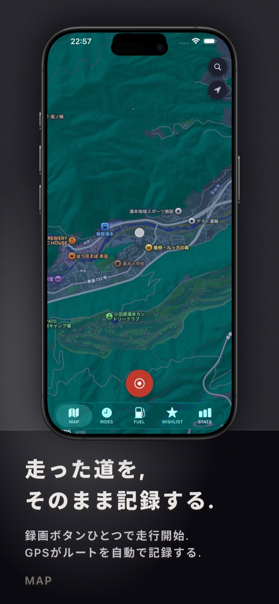
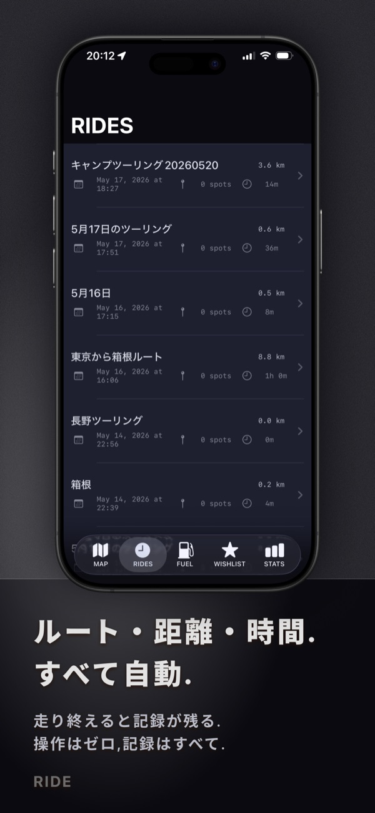
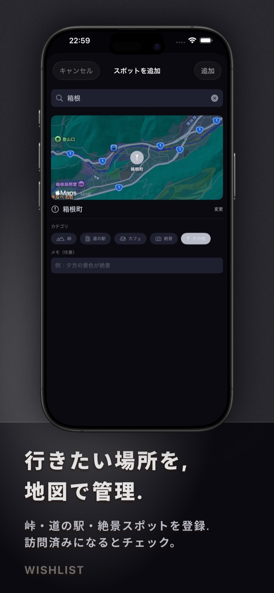
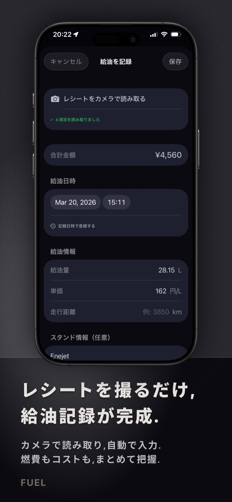
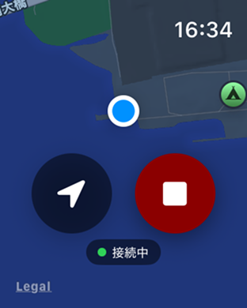

# Marga

> バイクツーリング向け記録・管理 iOS アプリ

---

## 概要

バイクツーリングに特化した記録アプリ。走行ルートの GPS 記録、給油コストの管理、行きたいスポットのウィッシュリストを 1 つのアプリでまとめて管理できる。

**開発期間**: 2026年（継続中）  
**開発形態**: 個人開発（AI を活用）  
**対応OS**: iOS 17+

---

## 主な機能

| 機能 | 概要 |
|---|---|
| **ルート記録** | GPS でリアルタイムに走行軌跡を記録。エリア名（例：「神奈川 → 静岡」）を自動付与 |
| **給油管理** | 給油量・単価・燃費を自動計算。レシート撮影 → OCR で自動入力 |
| **ウィッシュリスト** | 行きたい峠・道の駅・カフェ等をピンで地図管理。訪問済みフラグ付き |
| **統計** | 月別走行距離グラフ・燃費推移・給油費用を集計表示（Swift Charts） |
| **Apple Watch 連携** | Watch からワンタップで記録開始・停止（双方向同期） |
| **iCloud 同期** | SwiftData + CloudKit で複数端末・機種変更後も自動データ引き継ぎ |
| **JSON バックアップ** | 全データのエクスポート・インポート（UUID マージで重複なし） |
| **過去ルートハイライト** | 地図上に過去のツーリングルートを重ねて表示（期間フィルター付き） |

---

## 技術スタック

| 分類 | 技術 |
|---|---|
| UI フレームワーク | SwiftUI |
| データ永続化 | SwiftData + CloudKit |
| 地図 | MapKit（MKMapView UIViewRepresentable） |
| 画像認識 | Vision Framework（VNRecognizeTextRequest） |
| グラフ | Swift Charts |
| Watch 連携 | WatchConnectivity |
| 外部依存 | **なし**（CocoaPods / SPM 不使用） |

---

## ドキュメント

- [開発プロセス](./process.md) — タイムライン・設計の意思決定記録
- [技術的な工夫](./technical.md) — アーキテクチャ・難所と解決策

---

## スクリーンショット

App Store に掲載している画像です。

  
  
  
  

**Apple Watch**

Watch の画面から、iPhone を取り出さずに記録の開始・停止ができる。

---

## リンク

- [App Store](https://apps.apple.com/us/app/marga/id6763526779)
