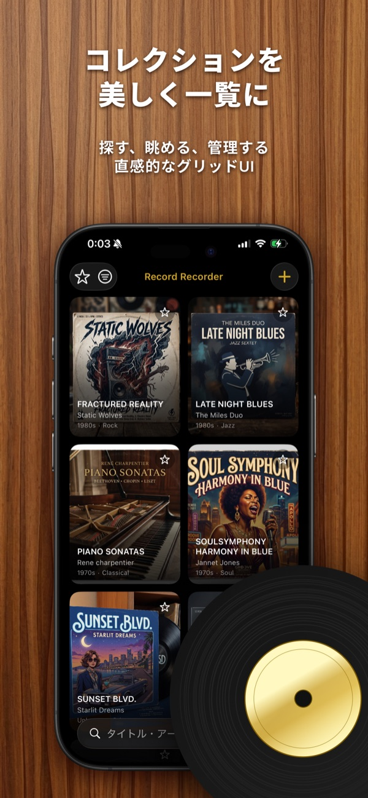
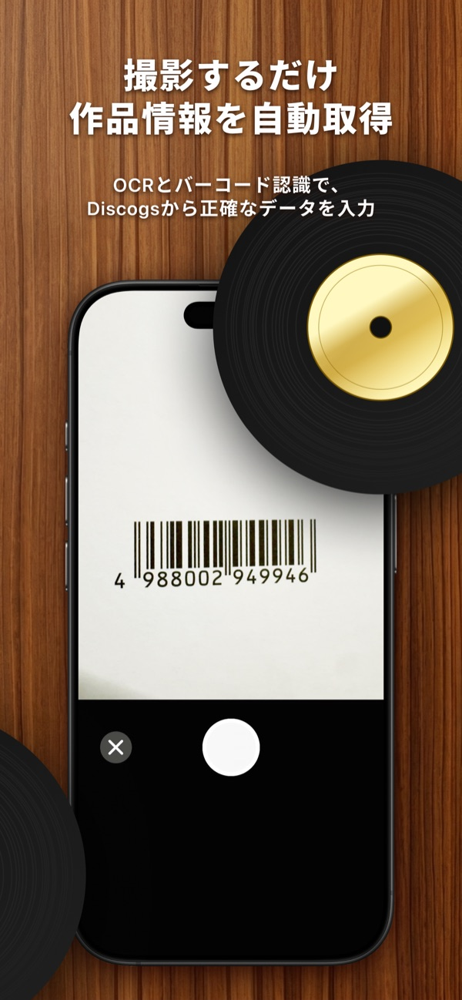
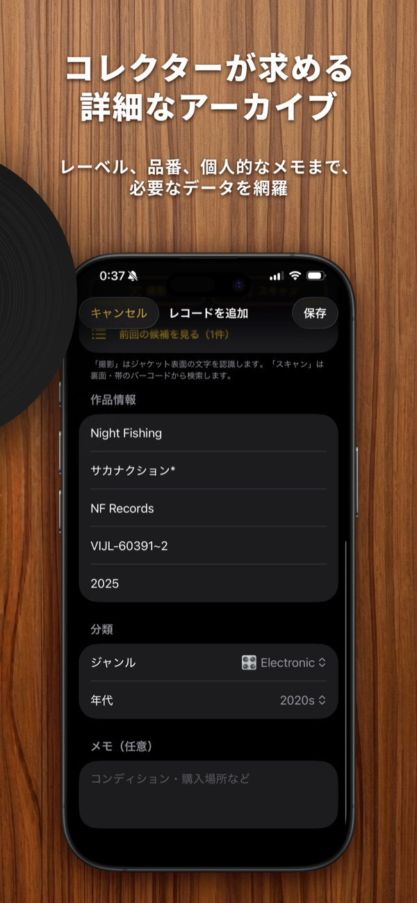
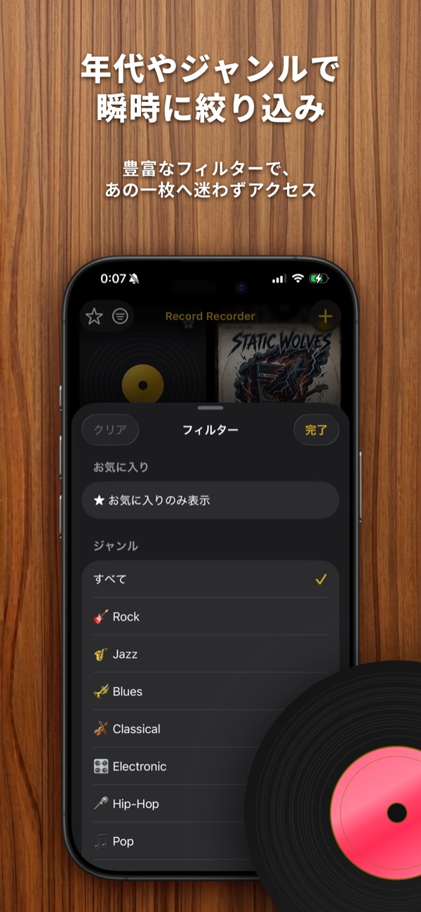
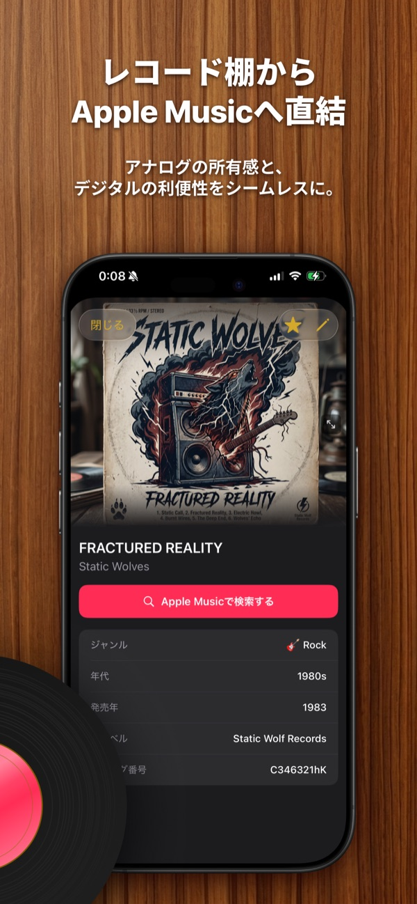

# Record Recorder

> レコードコレクター向けコレクション管理 iOS アプリ

---

## 概要

レコード（vinyl）のコレクションを手軽に管理するための iOS アプリ。
ジャケットを撮影するだけで、OCR・バーコード認識から Discogs API を通じてアルバム情報を自動取得できる。

**開発期間**: 2026年5月（MVP）〜 継続中  
**開発形態**: 個人開発（AI を活用）  
**対応OS**: iOS 17+

---

## 主な機能

| 機能 | 概要 |
|---|---|
| **自動認識** | ジャケット撮影 or バーコードスキャン → Discogs API でアルバム情報を自動入力 |
| **コレクション管理** | ジャンル・年代・お気に入りでの検索・フィルター・ソート |
| **iCloud 同期** | SwiftData + CloudKit で複数デバイス間を自動同期 |
| **統計表示** | ジャンル・年代の分布をグラフで可視化（SwiftCharts） |
| **CSV 入出力** | コレクションのエクスポート・インポート |
| **Apple Music 連携** | レコードの詳細画面から、同じ作品を Apple Music で検索 |

---

## 技術スタック

| 分類 | 技術 |
|---|---|
| UI フレームワーク | SwiftUI |
| データ永続化 | SwiftData + CloudKit |
| 画像認識 | Vision Framework（VNRecognizeTextRequest, VNDetectBarcodesRequest） |
| グラフ | Swift Charts |
| 外部 API | Discogs API（認証なし・無料） |
| 外部依存 | **なし**（CocoaPods / SPM 不使用） |

---

## ドキュメント

- [開発プロセス](./process.md) — 設計の意思決定・フェーズ別の実装記録
- [技術的な工夫](./technical.md) — アーキテクチャ・難所と解決策

---

## スクリーンショット

App Store に掲載している画像です。

  
  
  
  
  

---

## リンク

- [App Store](https://apps.apple.com/us/app/record-recorder/id6766056660)
- [ソースコード](https://github.com/dragonsystem/record-recorder)（非公開リポジトリ。閲覧をご希望の場合は[連絡先](../profile.md#連絡先)までご連絡ください）
