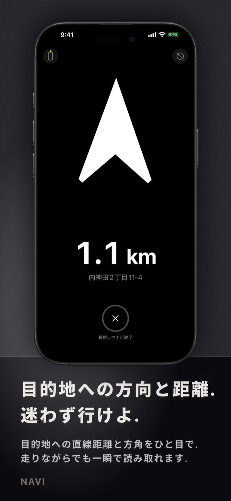
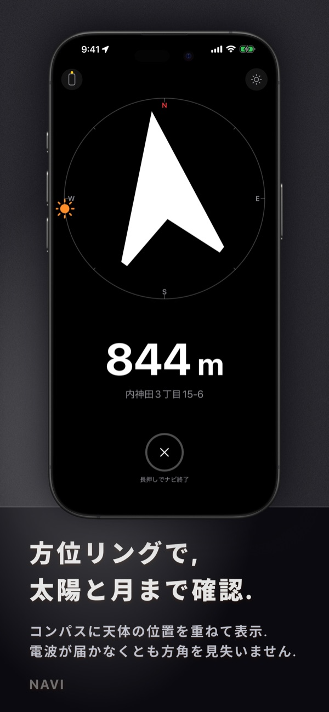
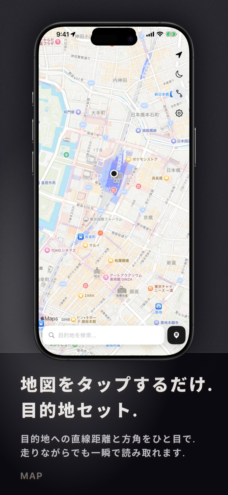
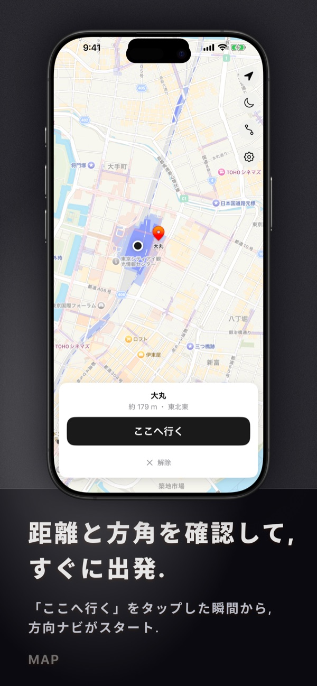
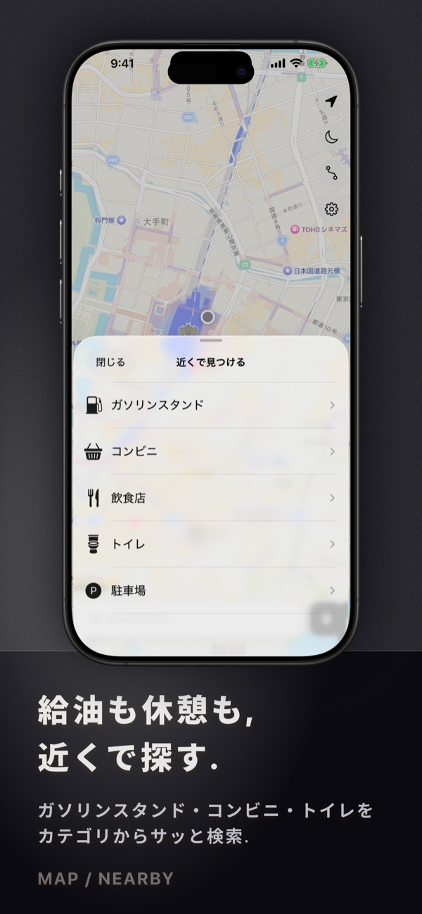
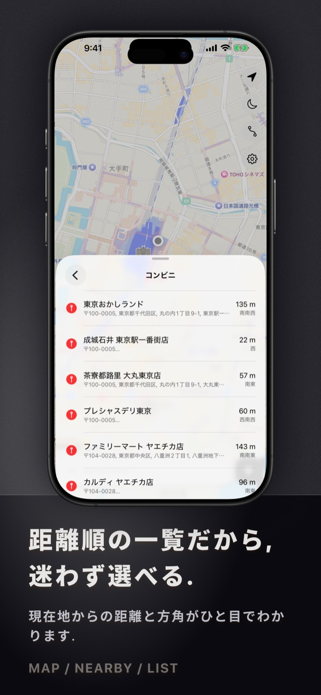
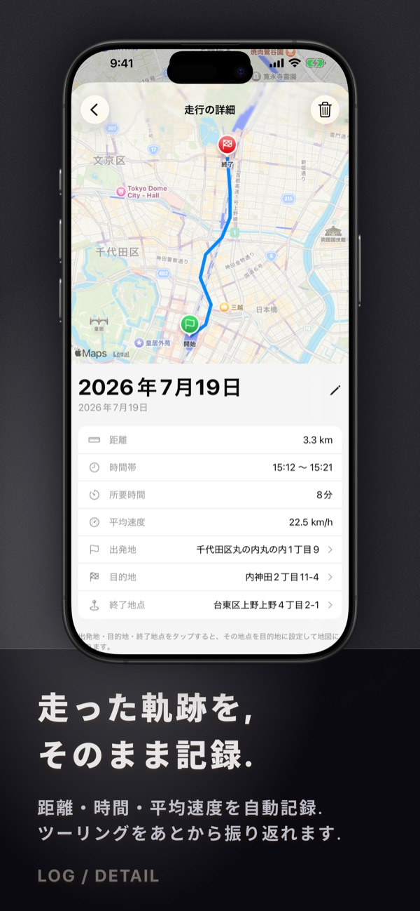
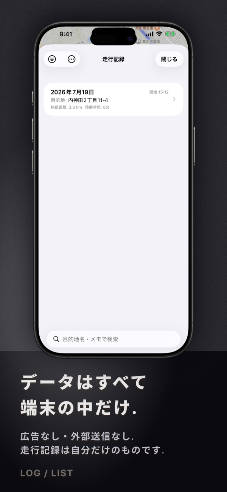

# Suchi

> バイク・自転車向けコンパス型直線ナビ iOS アプリ

---

## 概要

経路案内をしない、シンプルなコンパスナビ。  
目的地への**方角**と**直線距離**だけを画面いっぱいの矢印と数字で表示する。どの道を走るかはライダーが決める——ツーリングや散走の自由さを取り戻すためのアプリ。

**開発期間**: 2026年7月（v1.0 リリース）〜 継続中  
**開発形態**: 個人開発（AI を活用）  
**対応OS**: iOS 17+（iPhone）

---

## 主な機能

| 機能 | 概要 |
|---|---|
| **コンパスナビ** | 目的地への方角と直線距離を巨大な矢印+数字でフルスクリーン表示。端末の向きに追従してリアルタイム回転 |
| **目的地設定** | 地図の長押し または キーワード検索で目的地を指定 |
| **方位リング + 天体照合** | コンパスリングに太陽・月の方位を重ねて表示。車体の金属による磁気干渉をその場で確認可能 |
| **近くで見つける** | ガソリンスタンド・コンビニ・トイレなどを現在地からの距離・方角付きで一覧表示 |
| **走行記録** | GPS 軌跡・距離・時間・平均速度を自動保存。履歴から同じ目的地へ再ナビも可 |
| **JSON 引き継ぎ** | エクスポート/インポートで機種変更時のデータ引き継ぎに対応 |
| **多言語対応** | 日本語・英語対応。距離単位はロケール（m/km ⇔ ft/mi）に自動追従 |
| **ダークモード** | 夜間走行向け |

---

## 技術スタック

| 分類 | 技術 |
|---|---|
| UI フレームワーク | SwiftUI |
| 地図 | MapKit（SwiftUI Map + MKLocalSearch） |
| 位置情報 | CoreLocation（CLLocationManager, CLHeading） |
| データ永続化 | SwiftData |
| 方位・距離計算 | GeoMath.swift（自作） |
| 天体照合 | GeoAstro.swift（自作・太陽/月の方位を UTC 基準で計算） |
| 多言語 | String Catalog（118 キー、日本語/英語） |
| 外部依存 | **なし**（CocoaPods / SPM 不使用） |

---

## ドキュメント

- [開発プロセス](./process.md) — タイムライン・設計の意思決定記録
- [技術的な工夫](./technical.md) — アーキテクチャ・難所と解決策

---

## スクリーンショット

App Store に掲載している画像です。

  
  
  
  

  
  
  
  

---

## リンク

- [App Store](https://apps.apple.com/us/app/suchi-compass-beeline-nav/id6792340914)
