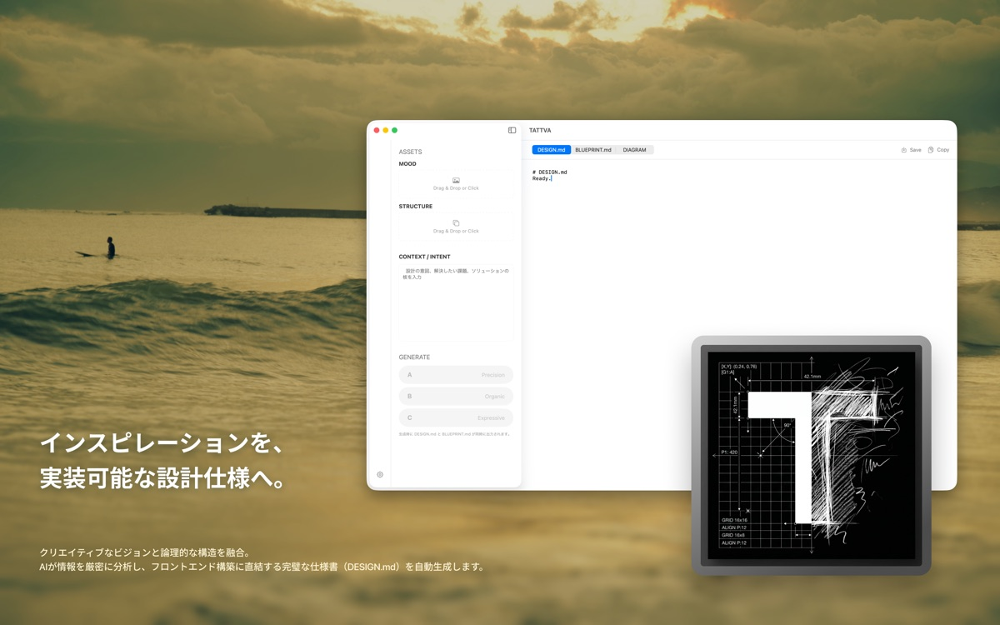
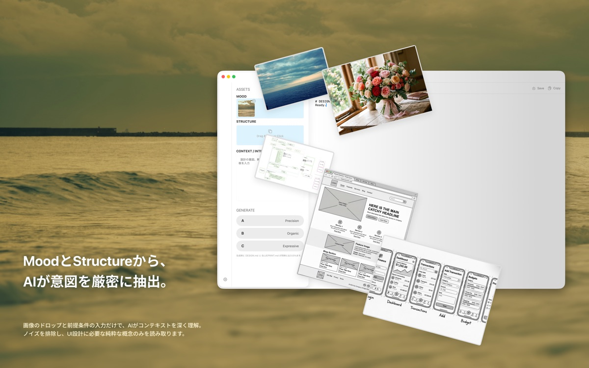
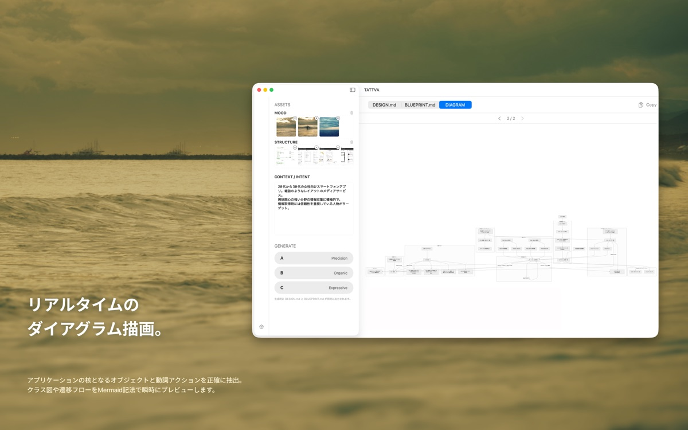
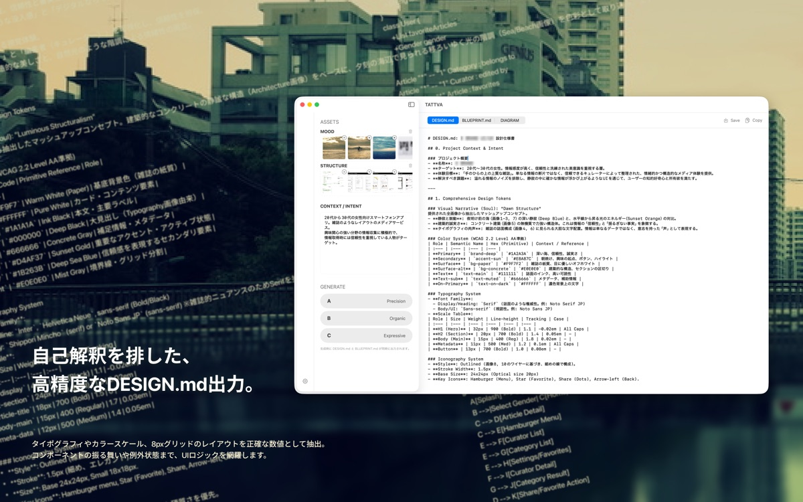
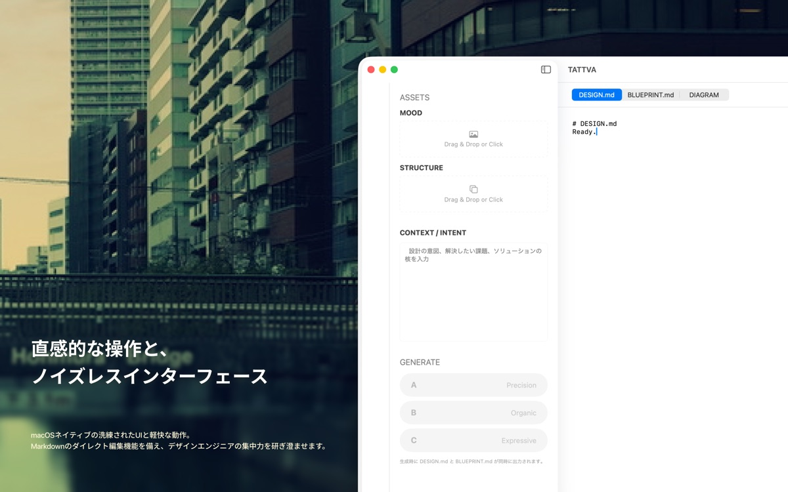

# TATTVA

> 画像とテキストから、AI でデザイン仕様書と UX 設計書を生成する macOS アプリ

---

## 概要

Mood 画像・Structure 画像・Context / Intent のテキストを入力すると、Google Gemini API で次の 2 つを生成する。

- **DESIGN.md**: Google Stitch 向けの機械可読なデザイン仕様（カラー・タイポグラフィ・コンポーネントのトークン定義）
- **BLUEPRINT.md**: 人が読むための UX 設計書（画面構成・ナビゲーションフロー図）

「TATTVA」はサンスクリット語で「本質」を意味する。デザインの本質を抜き出して言葉にする、というアプリの目的から名付けた。

**開発期間**: 2026年5月〜6月（2026年6月17日 リリース）  
**開発形態**: 個人開発（AI を活用）  
**対応OS**: macOS

---

## 主な機能

| 機能 | 概要 |
|---|---|
| **3 パターン生成** | Precision / Organic / Expressive の 3 つの方向性で生成 |
| **2 段階生成** | DESIGN.md → BLUEPRINT.md の順に生成し、両者の数値（カラーコード・フォントサイズ等）をそろえる |
| **Google Stitch 適合度チェック** | 生成した DESIGN.md が必要なキー・形式を満たしているかを自動チェック |
| **ダイアグラム表示** | BLUEPRINT.md の mermaid 図を描画。ズーム（2%〜2000%）・パン・PNG 書き出しに対応 |
| **自動リトライ** | API の一時的なエラー（503 / 429）を指数バックオフで最大 3 回再試行 |
| **テンプレート・履歴** | Context の保存と呼び出し、生成履歴（最大 20 件）の再読み込み |
| **マルチウィンドウ** | Cmd+N で複数ウィンドウを開き、別々の案を並行して生成 |

---

## 技術スタック

| 分類 | 技術 |
|---|---|
| UI フレームワーク | SwiftUI（macOS） |
| AI API | Google Gemini API（`generative-ai-swift` SDK、SPM） |
| ダイアグラム | mermaid.js（アプリ内に同梱）+ WKWebView |
| 認証情報の保存 | macOS Keychain |
| データ永続化 | UserDefaults / AppStorage |
| サンドボックス | App Sandbox + セキュリティスコープブックマーク |

---

## ドキュメント

- [開発プロセス](./process.md) — タイムライン・意思決定の記録
- [技術的な工夫](./technical.md) — 生成パイプライン・サンドボックス対応・ダイアグラム描画

---

## スクリーンショット

Mac App Store に掲載している画像です。

  
  

  
  

---

## リンク

- [Mac App Store](https://apps.apple.com/us/app/tattva/id6766077074?mt=12)
